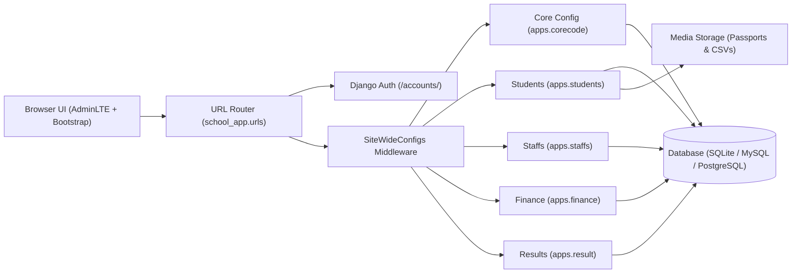
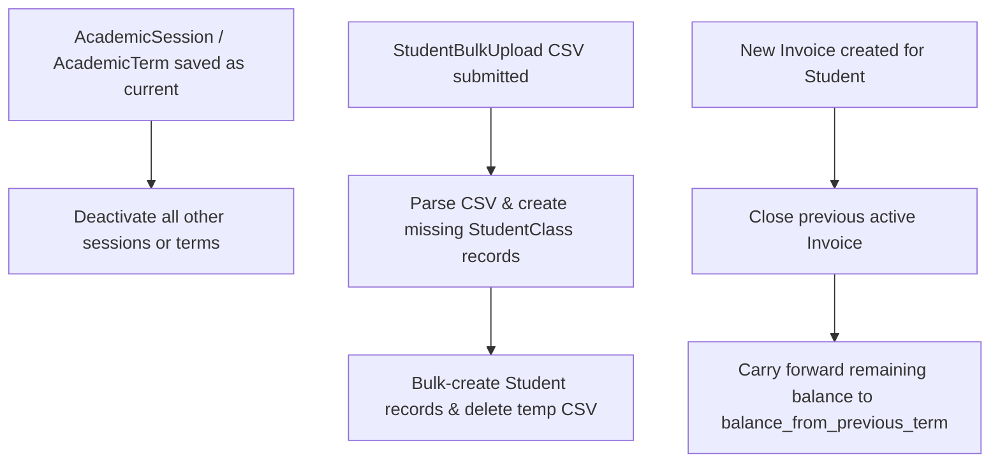
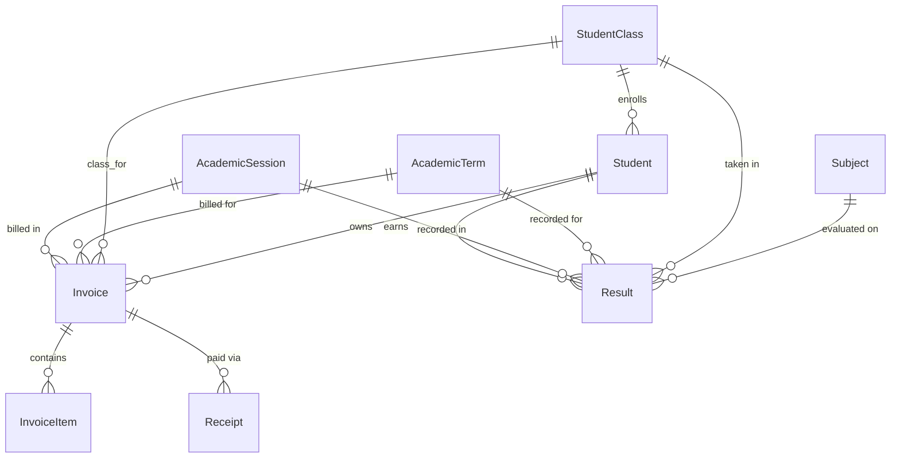

# School Management Application


[](https://www.python.org/)
[](https://www.djangoproject.com/)

[](LICENSE.txt)

A comprehensive Django-based web application built for school administrators to manage student records, staff profiles, academic sessions and results, fee invoicing, and site-wide settings from a unified dashboard.

---

## System Architecture



### Automated Signal Workflows



---

## Module & Feature Classification

| Module | Django App | Core Capabilities | Key Models | Base Path |
| :--- | :--- | :--- | :--- | :--- |
| **Core & Academics** | `apps.corecode` | Dashboard overview, site key-value settings, academic sessions, terms, classes, and subjects | `SiteConfig`, `AcademicSession`, `AcademicTerm`, `Subject`, `StudentClass` | `/` |
| **Student Management** | `apps.students` | Student CRUD, class assignment, passport photo uploads, CSV template download, and bulk CSV import | `Student`, `StudentBulkUpload` | `/student/` |
| **Staff Management** | `apps.staffs` | Staff registration, status tracking (`Active` / `Inactive`), contact details, and record updates | `Staff` | `/staff/` |
| **Financial Management** | `apps.finance` | Itemized student fee invoices, payment receipts, automatic prior-term balance carryover, and bulk invoicing | `Invoice`, `InvoiceItem`, `Receipt` | `/finance/` |
| **Result Management** | `apps.result` | Subject-level test and exam score entry, batch editing, total score calculation, and grading | `Result` | `/result/` |
| **Authentication** | `django.contrib.auth` | Login-protected views (`LoginRequiredMixin`), session timeout (`3 hours`), expire-on-close | `User` | `/accounts/` |

---

## Data Model Relationships



---

## Technology Stack

| Category | Technology | Version / Configuration | Role in Project |
| :--- | :--- | :--- | :--- |
| **Language** | Python | `3.8+` | Server-side runtime |
| **Backend Framework** | Django | `5.1.4` (`3.2+` compatible) | MTV architecture, ORM, auth, migrations, signals |
| **Form Helper** | `django-widget-tweaks` | `1.5.0` | Template-level form field styling |
| **Image Processing** | Pillow | `11.0.0` | Student passport image handling (`ImageField`) |
| **Database** | SQLite / MySQL / PostgreSQL | SQLite default (`db.sqlite3`) | Relational persistence (`DATABASES` configurable) |
| **Markup & Styling** | HTML5, CSS3 | Standard | Templates and custom stylesheets |
| **Scripting** | JavaScript / jQuery | ES6+ / bundled jQuery | Dynamic formsets, UI interactions, plugins |
| **UI Theme & Layout** | AdminLTE & Bootstrap | `AdminLTE v3.0.4` / `Bootstrap v4.4.1` | Responsive dashboard, navigation, cards, forms |
| **Icons & Tables** | Font Awesome, DataTables | Bundled in `static/plugins/` | Icons, sortable/filterable data tables |
| **Notifications & Scroll** | Toastr, OverlayScrollbars | Bundled in `static/plugins/` | Toast alerts and custom sidebar scrollbars |
| **Code Quality** | Black, isort, Flake8 | `24.10.0` / `5.13.2` / `7.1.1` | Code formatting, import sorting, linting |

---

## Installation and Setup

### Prerequisites

| Requirement | Minimum / Notes | Purpose |
| :--- | :--- | :--- |
| **Python** | `3.8+` | Running Django and management commands |
| **pip** | Included with Python | Installing dependencies from [requirements.txt](requirements.txt) |
| **Git** | Latest stable | Cloning the repository |

### Quick Start

```bash
# 1. Clone the repository
git clone https://github.com/madhanmohanreddyperam06/DSchool.git
cd DSchool

# 2. Create and activate a virtual environment
python -m venv venv
```

<details>
<summary><strong>Activate Virtual Environment (Windows / macOS & Linux)</strong></summary>

| Platform | Command |
| :--- | :--- |
| **Windows (PowerShell / CMD)** | `venv\Scripts\activate` |
| **macOS / Linux (bash / zsh)** | `source venv/bin/activate` |

</details>

```bash
# 3. Install Python dependencies
pip install -r requirements.txt

# 4. Apply database migrations (creates default admin & initial academic data)
python manage.py migrate

# 5. (Optional) Create an additional superuser
python manage.py createsuperuser

# 6. Start the development server
python manage.py runserver
```

Open `http://127.0.0.1:8000/` in your browser to access the dashboard.

### Default Seeded Configuration

Initial migration [0002_auto_20200506_1520.py](apps/corecode/migrations/0002_auto_20200506_1520.py) seeds a default administrator account and baseline academic records:

| Item | Seeded Values |
| :--- | :--- |
| **Admin Username** | `admin` |
| **Admin Password** | `admin123` |
| **Academic Session** | `2019/2020` (active) |
| **Academic Terms** | `1st Term` (active), `2nd Term`, `3rd Term` |
| **Classes** | `JSS 1`, `JSS 2` |
| **Subjects** | `Mathematics`, `English` |

> [!WARNING]
> Change the default `admin` password (`admin123`) immediately after your first login in any shared or production environment.

---

## Interactive References

<details>
<summary><strong>URL Route Reference (All Apps)</strong></summary>

#### Core & Academic Configuration (`apps.corecode`)

| Path | Route Name | Purpose |
| :--- | :--- | :--- |
| `/` | `home` | Main administrative dashboard |
| `/site-config` | `configs` | Edit `SiteConfig` key-value pairs |
| `/current-session/` | `current-session` | Set active `AcademicSession` and `AcademicTerm` |
| `/session/list/`, `/session/create/` | `sessions`, `session-create` | List and create academic sessions |
| `/session/<id>/update/`, `/session/<id>/delete/` | `session-update`, `session-delete` | Update or delete an academic session |
| `/term/list/`, `/term/create/` | `terms`, `term-create` | List and create academic terms |
| `/term/<id>/update/`, `/term/<id>/delete/` | `term-update`, `term-delete` | Update or delete an academic term |
| `/class/list/`, `/class/create/` | `classes`, `class-create` | List and create student classes |
| `/class/<id>/update/`, `/class/<id>/delete/` | `class-update`, `class-delete` | Update or delete a class |
| `/subject/list/`, `/subject/create/` | `subjects`, `subject-create` | List and create subjects |
| `/subject/<id>/update/`, `/subject/<id>/delete/` | `subject-update`, `subject-delete` | Update or delete a subject |

#### Students (`apps.students`)

| Path | Route Name | Purpose |
| :--- | :--- | :--- |
| `/student/list` | `student-list` | List all students |
| `/student/<id>/` | `student-detail` | View student profile and invoices |
| `/student/create/` | `student-create` | Register a new student |
| `/student/<id>/update/` | `student-update` | Update student record |
| `/student/delete/<id>/` | `student-delete` | Delete a student record |
| `/student/upload/` | `student-upload` | Bulk upload students via CSV |
| `/student/download-csv/` | `download-csv` | Download `student_template.csv` |

#### Staff (`apps.staffs`)

| Path | Route Name | Purpose |
| :--- | :--- | :--- |
| `/staff/list/` | `staff-list` | List all staff members |
| `/staff/<id>/` | `staff-detail` | View staff profile |
| `/staff/create/` | `staff-create` | Add a new staff member |
| `/staff/<id>/update/` | `staff-update` | Update staff details |
| `/staff/<id>/delete/` | `staff-delete` | Delete a staff member |

#### Finance (`apps.finance`)

| Path | Route Name | Purpose |
| :--- | :--- | :--- |
| `/finance/list/` | `invoice-list` | List all student invoices |
| `/finance/create/` | `invoice-create` | Create a single invoice |
| `/finance/<id>/detail/` | `invoice-detail` | View itemized invoice and payment balance |
| `/finance/<id>/update/` | `invoice-update` | Edit invoice and line items |
| `/finance/<id>/delete/` | `invoice-delete` | Delete an invoice |
| `/finance/receipt/create` | `receipt-create` | Record a payment receipt |
| `/finance/receipt/<id>/update/` | `receipt-update` | Update an existing receipt |
| `/finance/bulk-invoice/` | `bulk-invoice` | Generate invoices in bulk |

#### Results (`apps.result`)

| Path | Route Name | Purpose |
| :--- | :--- | :--- |
| `/result/create/` | `create-result` | Create student result records |
| `/result/edit-results/` | `edit-results` | Batch edit test and exam scores |
| `/result/view/all` | `view-results` | View all recorded student results |

</details>

<details>
<summary><strong>Student CSV Bulk Upload Schema</strong></summary>

Download the ready-to-fill template from `/student/download-csv/` (`student_template.csv`). Duplicate `registration_number` entries are automatically skipped, and unknown `current_class` names are auto-created.

| Column Header | Required | Notes |
| :--- | :--- | :--- |
| `registration_number` | Yes | Unique student identifier; rows without it are skipped |
| `surname` | Optional | Student surname |
| `firstname` | Optional | Student first name |
| `other_names` | Optional | Middle or other names |
| `gender` | Optional | Normalized to lowercase (`male` / `female`) |
| `parent_number` | Optional | 10–15 digit parent phone number |
| `address` | Optional | Residential address |
| `current_class` | Optional | Matches or creates a `StudentClass` record |

</details>

<details>
<summary><strong>Project Directory Structure</strong></summary>

```text
DSchool/
├── apps/
│   ├── corecode/          # Site config, sessions, terms, classes, subjects, middleware
│   ├── students/          # Student CRUD, passport uploads, bulk CSV import
│   ├── staffs/            # Staff CRUD and status tracking
│   ├── finance/           # Invoices, line items, receipts, bulk invoicing
│   └── result/            # Score entry, batch editing, grading utilities
├── school_app/
│   ├── settings.py        # Project configuration, logging (debug.log), sessions
│   ├── urls.py            # Root URL routing
│   ├── wsgi.py            # WSGI entry point
│   └── asgi.py            # ASGI entry point
├── static/                # AdminLTE, Bootstrap, Font Awesome, DataTables, Toastr, jQuery
├── templates/             # Base layout, dashboard, paginator, auth templates
├── media/                 # Uploaded student passport photos
├── manage.py              # Django management CLI
├── requirements.txt       # Pinned Python dependencies
├── .isort.cfg             # Import sorting configuration
├── LICENSE.txt            # MIT License
└── SECURITY.md            # Security reporting policy
```

</details>

---

## Testing & Code Quality

| Scope | Command | Description |
| :--- | :--- | :--- |
| **Full Test Suite** | `python manage.py test` | Run tests across all Django apps |
| **Core App Tests** | `python manage.py test apps.corecode` | Test models and views in `corecode` |
| **Students Tests** | `python manage.py test apps.students` | Test student management module |
| **Staffs Tests** | `python manage.py test apps.staffs` | Test staff management module |
| **Finance Tests** | `python manage.py test apps.finance` | Test invoicing and receipt logic |
| **Result Tests** | `python manage.py test apps.result` | Test result recording and grading |
| **Import Sorting** | `isort .` | Sort imports per [.isort.cfg](.isort.cfg) |
| **Code Formatting** | `black .` | Format Python code with Black |
| **Linting** | `flake8` | Check PEP 8 and lint rules |

---

## Roadmap

| Area | Planned Enhancement | Status |
| :--- | :--- | :--- |
| **Localization** | Multi-language support (`i18n`) | Planned |
| **API** | REST API for mobile app integration | Planned |
| **Portals** | Student self-service portal & parent-teacher communication | Planned |
| **Analytics & Alerts** | Advanced reporting analytics & email notifications | Planned |
| **Integrations & UX** | External payment gateways, responsive & performance improvements | Planned |

---

## Contributing, Security & License

| Topic | Details |
| :--- | :--- |
| **Contributing** | Fork the repo, create a feature branch (`git checkout -b feature/your-feature`), run tests and `isort .` / `black .`, and open a Pull Request. |
| **License** | Licensed under the MIT License — see [LICENSE.txt](LICENSE.txt). |
| **Security** | Review reporting guidelines in [SECURITY.md](SECURITY.md). |

---


## Contact Information

### Madhan Mohan Reddy

- **Email**: <madhanmohanreddyperam06@gmail.com>
- **Mobile**: +91 9110395993

---
<div align="center">
© 2026 Campus Finder. All rights reserved.
</div>


